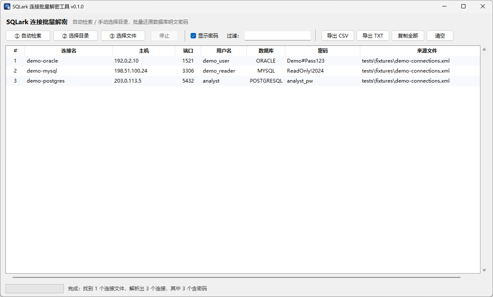

# Descifrador de conexiones de SQLark

[简体中文](README.md) · [繁體中文](README.zh-TW.md) · [English](README.en.md) · [日本語](README.ja.md) · [한국어](README.ko.md) · **Español** · [Français](README.fr.md) · [Deutsch](README.de.md) · [Русский](README.ru.md) · [Português (BR)](README.pt-BR.md)

[](LICENSE)
[](https://www.python.org/)
[](#)
[](../../actions/workflows/ci.yml)

Herramienta que analiza los archivos de conexión guardados por **SQLark (百灵)**
(`connectionInfo.xml` / `connection-server.xml`) y recupera las contraseñas de base de datos
cifradas en ellos.

> [!WARNING]
> Esta herramienta está pensada **únicamente** para la recuperación de credenciales,
> auditorías de contraseñas y autoevaluación de seguridad en equipos propios o autorizados.
> No la utilices en ordenadores o bases de datos de terceros sin permiso.
> Consulta [SECURITY.md](SECURITY.md).

> [!NOTE]
> Unofficial community project — not affiliated with or endorsed by SQLark or DM.

---

## Funciones

- **Búsqueda automática** en `~/.SQLark`, `%APPDATA%\SQLark`, Escritorio/Documentos/Descargas
  y las carpetas de instalación de SQLark de todas las unidades;
- **Selección manual** de una carpeta (escaneo recursivo) o de archivos concretos;
- **Descifrado por lotes** de nombre, host, puerto, usuario, tipo de base de datos y contraseña;
- **GUI + CLI**: aplicación Tkinter para el día a día y CLI para automatizar;
- **Exportación** a CSV (UTF-8 BOM, compatible con Excel), TXT y JSON;
- **Totalmente offline**: sin red, sin subidas, sin escribir en el registro;
- **Empaquetado sencillo** en un único `.exe` de Windows con un comando.



> Los hosts, usuarios y contraseñas de la captura son datos de demostración
> (redes de documentación RFC 5737).

---

## Inicio rápido

### 1. Descargar el ejecutable

Descarga `sqlark-connection-decryptor-v*-windows-x64.exe` desde [Releases](../../releases) y haz doble clic.
No requiere instalar Python. Para scripts, usa la versión de consola
`sqlark-connection-decryptor-cli-v*-windows-x64.exe`.

Los binarios CLI para Linux y macOS también están en Releases (`linux-x64`, `linux-arm64`, `macos-arm64`, `macos-x64`).

### 2. Ejecutar desde el código fuente

```bash
git clone https://github.com/muemios/sqlark-connection-decryptor.git
cd sqlark-connection-decryptor
pip install -e .
python -m sqlark_decrypt          # abre la GUI
```

### 3. Usar la CLI

```bash
python -m sqlark_decrypt scan --auto
python -m sqlark_decrypt decrypt "C:\Users\me\.SQLark\connectionInfo.xml"
python -m sqlark_decrypt decrypt "*.xml" --csv result.csv --txt result.txt --json result.json
```

Ejemplo de salida:

```
Conexión        Host            Puerto  Usuario       BD            Contraseña
----------------------------------------------------------------------------
demo-oracle     192.0.2.10       1521   demo_user     ORACLE        Demo#Pass123
demo-mysql      198.51.100.24    3306   demo_reader   MYSQL         ReadOnly!2024
demo-postgres   203.0.113.5      5432   analyst       POSTGRESQL    analyst_pw
```

### 4. Compilar el exe de Windows

```powershell
powershell -ExecutionPolicy Bypass -File scripts/build_exe.ps1
# salida: dist\sqlark-connection-decryptor-v*-windows-x64.exe
```

---

## Archivos compatibles

| Archivo | Descripción |
| --- | --- |
| `%USERPROFILE%\.SQLark\connectionInfo.xml` | Todas las conexiones locales de SQLark (lo habitual) |
| Cualquier `connection-server.xml` exportado | Generado con "Exportar conexiones" |
| `connections.xml` y similares | Cualquier archivo cuya raíz sea `<CONNECTIONS>` |

Probado con **SQLark 4.x** (controladores Oracle / MySQL / PostgreSQL / DM).
Si el fabricante cambia el cifrado, la herramienta falla de forma explícita en lugar de
devolver una contraseña incorrecta.

---

## Cómo funciona

SQLark aplica **dos capas de AES-128-CBC (PKCS5Padding)**:

1. **Capa externa**: todo el campo `<connectionDetail>` / `<superAttr>`
   `Base64(AES(JSON, key="fudih4xp113znwp7", iv=reverse(key)))`
2. **Capa interna**: `password` / `sshPassword` / `sslPassword` dentro del JSON
   `Base64(AES(texto plano, key=salt, iv=reverse(salt)))`, donde `salt` es una cadena
   aleatoria de 16 caracteres guardada junto al criptograma.

Las notas completas de ingeniería inversa, las clases Java y el análisis de seguridad están en
[docs/encryption.md](docs/encryption.md) (en chino).

---

## Estructura del proyecto

```
sqlark-decryptor/
├── sqlark_decrypt/          # paquete Python reutilizable
│   ├── crypto.py            # primitivas AES de dos capas
│   ├── parser.py            # análisis XML + composición de capas
│   ├── scanner.py           # búsqueda de archivos
│   ├── export.py            # CSV / TXT / TSV / JSON
│   ├── cli.py               # subcomandos gui / scan / decrypt
│   └── gui.py               # interfaz Tkinter
├── tests/                   # 34 pruebas unitarias con datos sintéticos
├── scripts/                 # compilación, datos de demo, icono, escaneo de secretos
├── docs/                    # cifrado, arquitectura, desarrollo, publicación
├── .github/workflows/       # CI y release automático por tag
└── pyproject.toml
```

---

## Desarrollo

```bash
pip install -e ".[dev]"
pytest
ruff check .
python scripts/check_no_secrets.py
python scripts/check_i18n.py     # verifica los enlaces de los README traducidos
```

- Los datos de prueba los genera `scripts/make_fixture.py` y son totalmente ficticios
  (rangos IP de documentación + contraseñas de ejemplo).
- Reglas de contribución en [CONTRIBUTING.md](CONTRIBUTING.md).

---

## Privacidad y seguridad de datos

- La herramienta no se conecta a la red, no sube nada y no modifica los archivos de SQLark;
- El resultado puede contener **contraseñas de bases de datos de producción**: no las
  incluyas en Git, nubes ni tickets;
- El repositorio incluye un `.gitignore` para archivos reales y
  `scripts/check_no_secrets.py` (también en CI).

---

## Preguntas frecuentes

**La búsqueda automática no encuentra nada** → usa "Seleccionar carpeta" y elige
`C:\Users\<usuario>\.SQLark`.

**La columna de contraseña está vacía** → la conexión se guardó sin "recordar contraseña".

**Falla el análisis** → puede que SQLark haya cambiado el cifrado. Abre un issue indicando la
versión de SQLark (**nunca adjuntes un archivo de conexión real**).

---

## Licencia

[MIT](LICENSE) © 2026 SQLark Decryptor contributors

---

## Palabras clave

Descifrador de contraseñas SQLark, recuperación de contraseñas SQLark 百灵, recuperación de
contraseñas de conexión de bases de datos, contraseñas guardadas de Oracle / MySQL /
PostgreSQL / DM, ingeniería inversa AES-128-CBC, recuperación de credenciales, auditoría de
seguridad, herramienta Tkinter, auditoría offline de contraseñas, connectionInfo.xml,
connection-server.xml.
